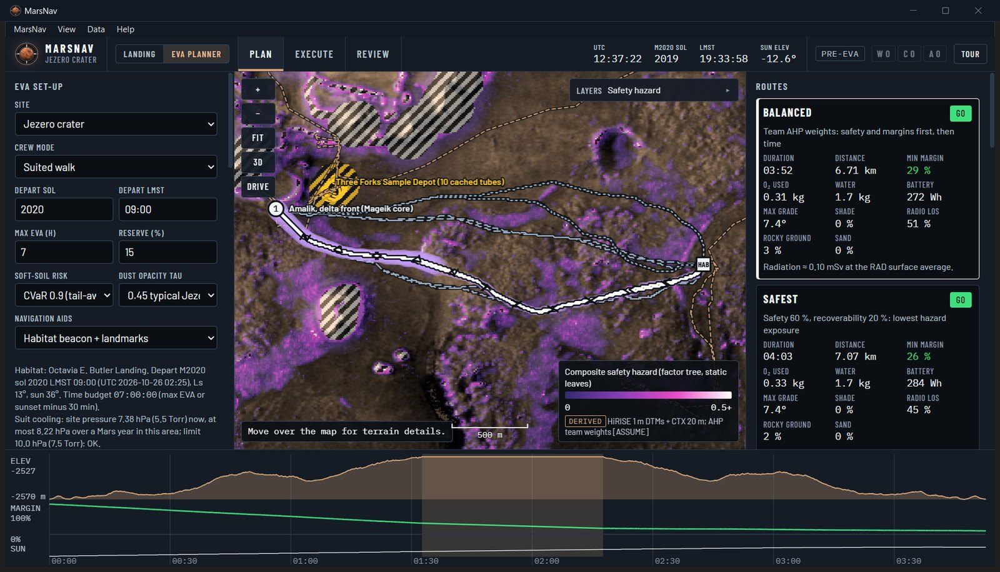
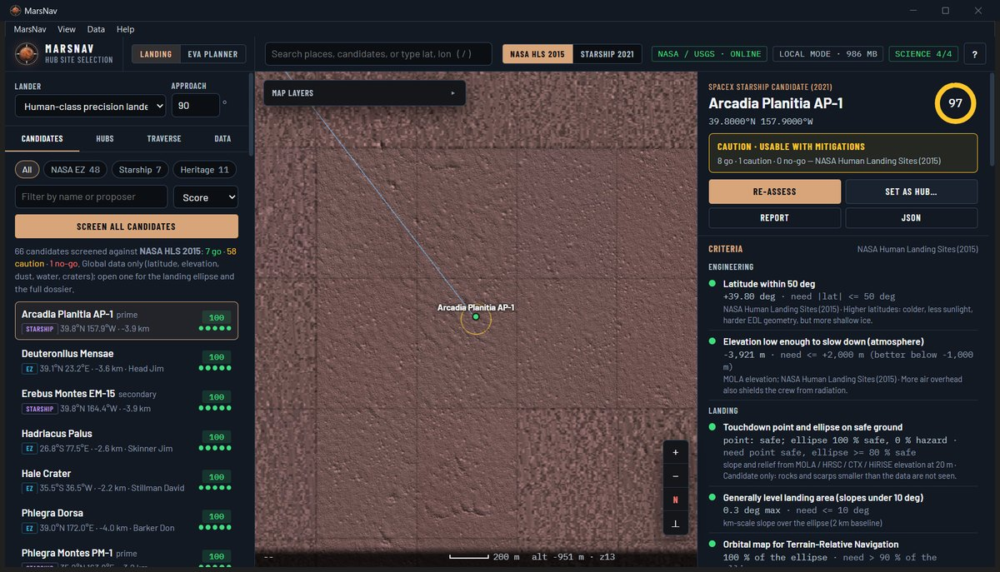
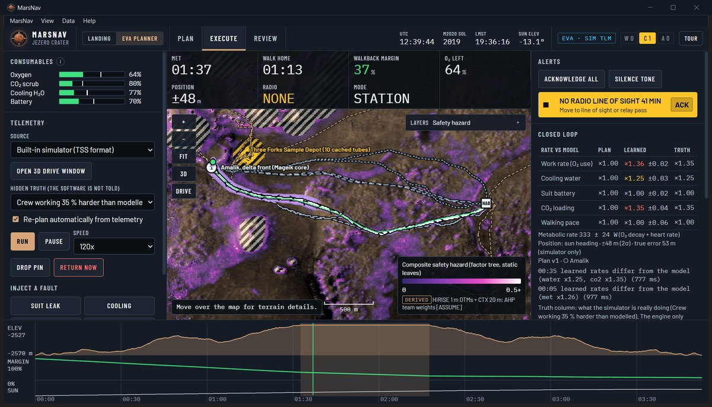

<p align="center">
  <br>
  <sub>Logo: AI-generated</sub>
</p>

<h1 align="center">MarsNav</h1>

<p align="center">
  <b>Landing-site selection and EVA navigation for the first humans on Mars, on real NASA and USGS data.</b><br>
  NASA Space Apps Challenge 2026 · <i>Interplanetary Survival Guide: Martian Map</i>
</p>

<p align="center">
  <a href="MarsNav_User_Guide.pdf"><b>User guide (PDF, 55 pages)</b></a> ·
  <a href="#run-it">Run it</a> ·
  <a href="#checked-against-perseverance">Validation</a> ·
  <a href="docs/">Technical documents</a>
</p>



A Mars crew will ask two questions before every Marswalk: **where do we land and live**, and **which way do we go, and can we always get home?** There is no GPS on Mars, help is 4 to 24 light-minutes away, suit oxygen, water and battery are finite, and Spirit was lost in soil that looked firm from orbit.

MarsNav answers both questions with one safety logic, from choosing the landing site to the last step of each EVA:

- **Landing mode** streams the whole of Mars and screens 66 candidate sites against NASA's 2015 human landing-site criteria (or the 2021 Starship study), with a full dossier per site: landing ellipse, surface, water ice, craters, radiation and sunlight. The chosen site becomes a hub and a full EVA site at 1 to 20 m resolution.
- **The EVA planner** checks hard limits first (slope, cliffs, soft soil, keep-outs, daylight, the walk home) and then plans five named routes. It flies the EVA against suit telemetry in NASA's SUITS format, learns how hard the crew is really working, re-plans from where they actually are, and turns the crew home before the margin is gone.
- **Local mode and Mars mode** put every dataset on the computer at native resolution and then cut the app off from the internet, as it would run on Mars. Every refused request is counted on screen.

It is a portable Windows desktop app: one folder, one double-click, nothing to install.

## What it does

| | |
|---|---|
| **Landing mode** | Whole-planet globe on MOLA, HRSC, CTX and HiRISE data, down to 25 cm imagery. 66 candidates (NASA Exploration Zones, Starship sites, heritage landers) screened in seconds; a dossier for any point on Mars; a safety map of lander-safe ground; long traverses by pressurised rover; "commit the hub" builds the EVA site. |
| **Plan** | Stations with their tasks, suit and rover checkout state, then five routes: balanced, safest, fastest, lowest consumption and a fallback in a different corridor. Each shows time, distance, O₂, water, battery, walk-home margin, radiation dose and data confidence. The best set and order of stations is found exactly (Held-Karp). When no plan can work, it shows the point of no return and the resource that runs out. A 3D view walks the route at eye height against the real crater skyline. |
| **Execute** | Telemetry from the built-in simulator, a first-person drive window, or live from a SUITS Telemetry Stream Server. Live consumables with the walk-home need marked, a navigation filter with its error ellipse (no GPS), caution and warning, station procedures, voice queries, and an automatic return on a critical fault. |
| **Review** | Planned against flown, the event log, the paper cue card crews carry, routes as GeoJSON, and the validation against Perseverance. |
| **Offline** | Local mode measures and downloads the whole-planet datasets and every high-resolution product around each site; Mars mode then refuses every internet request. The EVA planner needs no internet at any time. |

<table>
  <tr>
    <td width="50%"></td>
    <td width="50%"></td>
  </tr>
  <tr>
    <td>Landing mode: Arcadia Planitia AP-1 assessed against NASA's 2015 criteria.</td>
    <td>Execute: suit telemetry, consumables, caution and warning, and the closed loop.</td>
  </tr>
</table>

## Run it

**Windows 10 or 11 (64-bit):**

1. Download `MarsNav-Windows.zip` from the latest release, or build it yourself with `build_exe.bat` (it appears in `dist\`).
2. Unzip it anywhere you can save files (Desktop, Documents, `D:\`, a USB stick) and double-click **`MarsNav.exe`**.
3. The first time on a new PC, Windows may say "Windows protected your PC" because the program is not code-signed: click **More info**, then **Run anyway**.

No Python, no installer and no admin rights are needed. The window uses Microsoft Edge WebView2, which is part of Windows 10 and 11. For a two-minute tour, press **Tour** in the top bar; the [user guide](MarsNav_User_Guide.pdf) walks through every feature with screenshots.

**Any OS, EVA planner only:** `python3 -m http.server 8765 --directory app`, then open `http://localhost:8765`.

## Checked against Perseverance

Every result is reported, including the one that did not go our way. Figures re-run on 26 October 2026.

| Check | Result |
|---|---|
| Mars clock vs Perseverance MEDA sun geometry | Solar zenith angle error 0.001 ± 0.086° over 5,616 samples on 117 sols |
| Terrain vs the rover | Walking-scale slope at or above the rover's measured tilt at 74 % of 480 points (r = 0.72) |
| False no-go rate | 2 % of 703 real Perseverance positions |
| Hazard model vs JPL's route choices | The rover's real path scores lower than the straight line on 21 of 30 detour drives |
| Route geometry vs the rover's drives | **Not** better than a straight line (38 m vs 34 m): reported as a negative result |
| Closed loop vs flying the filed plan | 40 paired EVAs: 0 of 40 dipped into the reserve with the loop, 31 of 40 without (Wilcoxon p < 0.001) |
| Against NASA's TSS2027 telemetry server | Learned an 8× faster battery and CO₂ drain and turned the EVA home within about 2 minutes |
| Same trip as the rover | Séítah to the delta front: Perseverance drove 7.1 km over 85 sols; MarsNav planned 3.07 km in under a second (a suited crew: 2.92 km, 1.4 h). Over 45 real drives its routes cross 47 % less mapped sand and 55 % less rocky ground than the rover did, and its speed model reproduces the rover's measured 79.7 m/h (79 m/h) |
| Reproducibility | A full rebuild from the raw USGS files gives byte-identical layers |

78 automated tests pass: 63 engine and closed-loop tests (Node) and 15 pipeline and downloader tests (pytest). The desktop server passes an end-to-end self-test under load, including a first run from an empty data folder. Details: [`validation/REPORT.md`](validation/REPORT.md), [`validation/ROVER_CASE_STUDY.md`](validation/ROVER_CASE_STUDY.md), [`validation/CLOSED_LOOP.md`](validation/CLOSED_LOOP.md), [`docs/05_verification_and_validation.md`](docs/05_verification_and_validation.md).

## How it works

| Layer | Built with |
|---|---|
| Desktop app | Python launcher compiled with PyInstaller; native window through pywebview on Microsoft Edge WebView2; a supervisor with a Windows job object, health checks and automatic restarts. |
| Interface | HTML, CSS and JavaScript modules, no framework; three.js for 3D; the planning engine in a Web Worker. Display rules informed by NASA-STD-3001 Vol. 2. |
| Planning engine | Plain JavaScript (`engine/`): terrain, cost model, planner, walk-home fields, physiology, Mars clock, environment, AHP, risk (CVaR), sortie selection (Held-Karp, QUBO), simulation, closed loop and navigation filter, caution and warning. The same code runs in the app, the tests and the validation. |
| Planet engine | Python (`planet/`): tile server and disk cache, MOLA / HRSC / CTX / HiRISE readers over GDAL in worker processes, USGS STAC catalogue, landing assessment, site generator, Local mode, SUITS telemetry bridge. |
| Data pipeline | Python with numpy, scipy, rasterio / GDAL and Pillow (`pipeline/`): downloads with SHA-256 checks, walking-scale terrain statistics from 1 m HiRISE models, hazard layers, imagery, weather fit. |

Hard limits come first and are never traded against time; a partial route from which the crew could not walk home is dropped during the search. Only then are routes optimised over time, hazard, consumables, recoverability and science, with weights from AHP and a live consistency ratio. See [`docs/03_algorithms.md`](docs/03_algorithms.md).

## Repository

| Path | Contents |
|---|---|
| `app/` | The application: pages, styles, scripts, the bundled engine, pre-built site data, fonts and three.js |
| `engine/` | The planning engine (JavaScript modules), shared by the app, tests and validation |
| `planet/` | The planet engine and local server: tiles, data readers, landing assessment, site builder, Local mode, telemetry |
| `pipeline/` | The data pipeline and site definitions (`pipeline/sites/*.json`) |
| `launcher/` | The desktop app: launcher, native window, packaging |
| `validation/` | Validation against Perseverance and the closed-loop campaign, with reports |
| `tests/` | Engine and closed-loop tests (Node), pipeline and downloader tests (pytest) |
| `tools/` | Build scripts, the SUITS telemetry bridge, test helpers, the figure script and the user-guide builder (`tools/guide/`) |
| `docs/` | Concept of operations, architecture, algorithms, data provenance, verification, requirements traceability, deployment, limitations, closed loop |
| `submission/` | Project submission text, judging-criteria map, demo script, comparison with other approaches |

## Build and test from source

```bat
build_exe.bat                         :: Windows: builds MarsNav.exe and dist\MarsNav-Windows.zip
selftest.bat                          :: end-to-end server check under load
```

```sh
node --test tests/*.test.mjs          # 63 engine and closed-loop tests (Node 20+)
python -m pytest tests -q             # 15 pipeline and downloader tests (pip install -r requirements.txt)
node validation/validate.mjs          # validation against Perseverance data (about 30 s)
node validation/rover_case_study.mjs  # same trips as Perseverance, MarsNav vs the rover (about 15 s)
node validation/closed_loop_campaign.mjs   # 40 paired closed-loop EVAs (about 70 s)
bash tools/build_all.sh               # rebuild every data product from the raw USGS / NASA files
python tools/guide/builder/build.py   # rebuild MarsNav_User_Guide.pdf (pip install reportlab)
```

## Data and credits

Mars data from NASA and the USGS Astrogeology Science Center: HiRISE and CTX (MRO), MOLA and TES (MGS), THEMIS and GRS (Mars Odyssey), HRSC (Mars Express), the MEDA weather station, the rover traverse and RAD radiation records (Mars 2020, MSL), the Viking colour mosaic, the global geologic map (USGS SIM 3292), the SWIM ice maps and the Robbins & Hynek crater database. Candidate sites from NASA's 2015 Human Landing Sites workshop and Golombek et al. (2021). Full provenance and citations: [`docs/04_data_and_provenance.md`](docs/04_data_and_provenance.md) and the user guide.

MarsNav is an independent project built for the NASA Space Apps Challenge 2026. It is not a NASA product and is not endorsed by NASA.

**Use of AI.** We used an AI coding assistant (Anthropic's Claude) to help write, test and document MarsNav to the team's design; the team reviewed and tested every change. The logo was made with an AI image generator and carries a visible "AI-generated" watermark. All data is real mission data and every result can be re-run from the code. Details: [`docs/AI_USE.md`](docs/AI_USE.md).

Fonts: Barlow and IBM Plex Mono (SIL Open Font License). 3D: three.js (MIT).

## License

MIT. See [`LICENSE`](LICENSE).
