<p align="center">
  <a href="https://aryan221224.github.io/MarsNav/">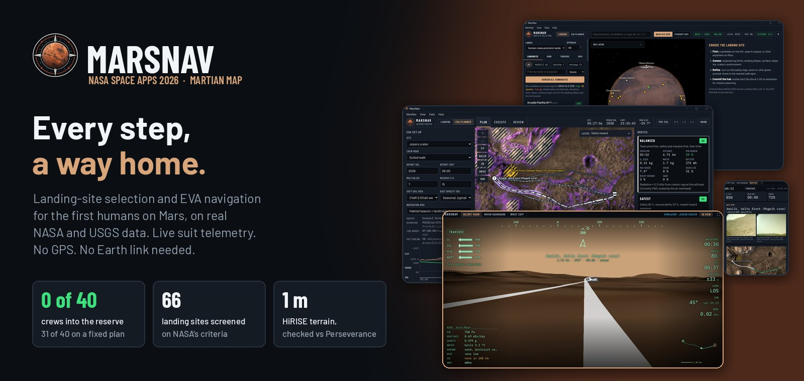</a><br>
  <sub>Logo: AI-generated · every screen shown is the running app</sub>
</p>

<p align="center">
  <a href="https://github.com/Aryan221224/MarsNav/actions/workflows/windows-exe.yml"></a>
  
  
  
  
</p>

<h3 align="center">
  <a href="https://aryan221224.github.io/MarsNav/">▶ Try it in your browser</a> &nbsp;·&nbsp;
  <a href="https://youtu.be/n4fgprexx3E">Demo video (30 s)</a> &nbsp;·&nbsp;
  <a href="https://github.com/Aryan221224/MarsNav/releases/latest">Download for Windows</a>
</h3>

<p align="center">
  <a href="MarsNav_User_Guide.pdf">User guide (PDF, 86 pages)</a> ·
  <a href="#run-it">Run it</a> ·
  <a href="#checked-against-perseverance">Validation</a> ·
  <a href="docs/">Technical documents</a> ·
  NASA Space Apps Challenge 2026 · <i>Interplanetary Survival Guide: Martian Map</i>
</p>

---

**On Mars there is no GPS, help is 3 to 22 light-minutes away, and a suit carries a fixed supply of oxygen, water and battery. Spirit was lost in soil that looked firm from orbit.** A Mars crew will ask two questions before every Marswalk: *where do we land and live*, and *which way do we go, and can we always get home?*

MarsNav answers both with one safety logic, from choosing the landing site to the last step of each EVA, on real NASA and USGS data, and it keeps working with no Earth link.

<table>
  <tr>
    <td width="33%" valign="top"><h3>🛡️ Never lose the way home</h3>Hard limits first (slope, cliffs, soft soil, keep-outs, daylight), then five named routes. Any partial route from which the crew could not walk home is dropped <i>during</i> the search, so the walk home holds at every step, not only at the turnaround.</td>
    <td width="33%" valign="top"><h3>📡 Learns from the suit</h3>Reads live telemetry in NASA's SUITS format, learns how hard the crew is really working and how fast water and battery drain, re-plans from where they actually are, and turns them home before the margin is gone.</td>
    <td width="33%" valign="top"><h3>🔬 Proven on real rover data</h3>Checked against Perseverance's own drives, sun geometry and tilt, and Curiosity's radiation detector, every result with its 95 % interval. In 40 paired EVAs: <b>0 of 40</b> crews touched the reserve, against <b>31 of 40</b> on a fixed plan.</td>
  </tr>
</table>

## See it work

### 1 · Choose where to land and live

<table>
  <tr>
    <td width="50%">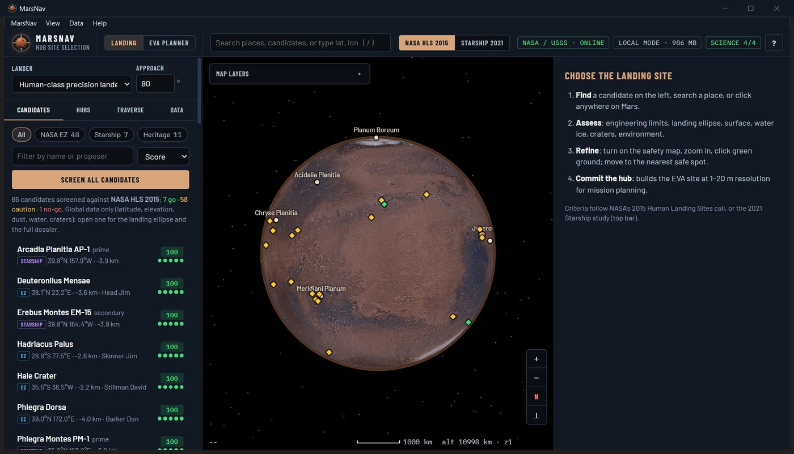</td>
    <td width="50%">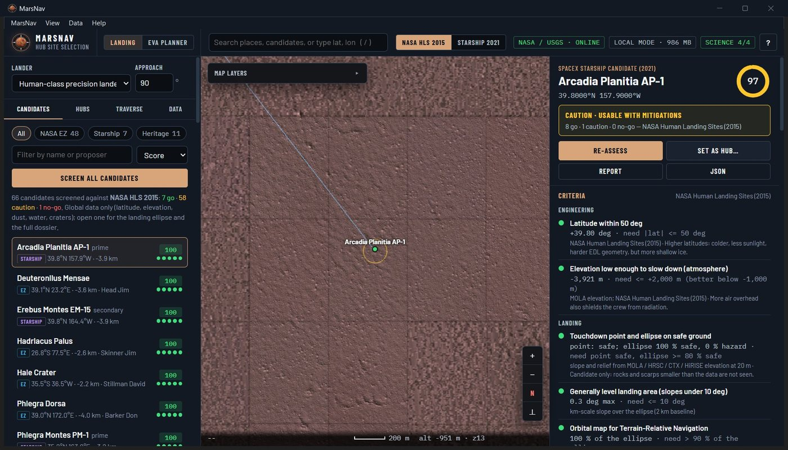</td>
  </tr>
  <tr>
    <td>The whole planet streams from MOLA down to 1 m HiRISE. 66 candidates (NASA Exploration Zones, Starship sites, heritage landers) are screened in seconds against NASA's 2015 criteria.</td>
    <td>Any point on Mars gets a dossier: engineering limits, a Monte Carlo landing ellipse, water ice, thermal inertia, craters, radiation. <b>Commit the hub</b> builds an EVA site there from the best data the place has.</td>
  </tr>
  <tr>
    <td>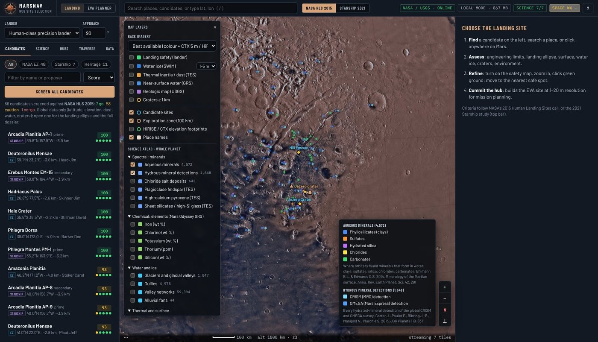</td>
    <td>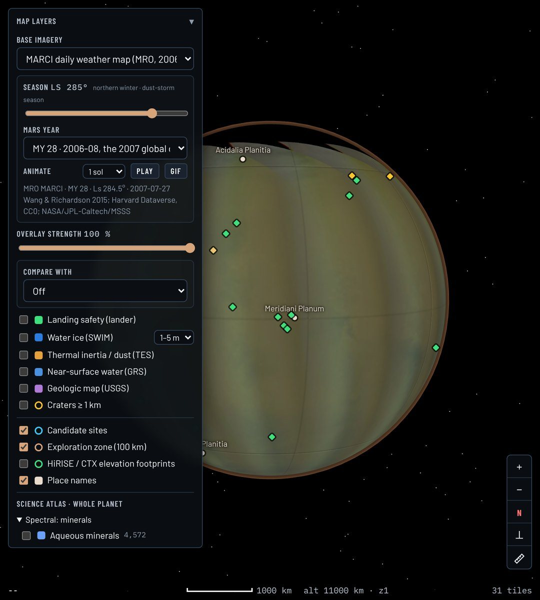</td>
  </tr>
  <tr>
    <td>A science atlas of 34 whole-planet layers (minerals, chemistry, ice, gravity, dust, radiation, present-day activity), and seven science objectives that rank every site.</td>
    <td>Mars weather the way NASA Worldview shows Earth: MRO MARCI daily maps of past years, dust by season, Earth-relay passes.</td>
  </tr>
</table>

<table>
  <tr>
    <td width="33%">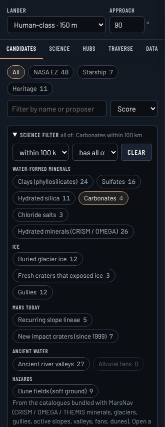</td>
    <td width="33%">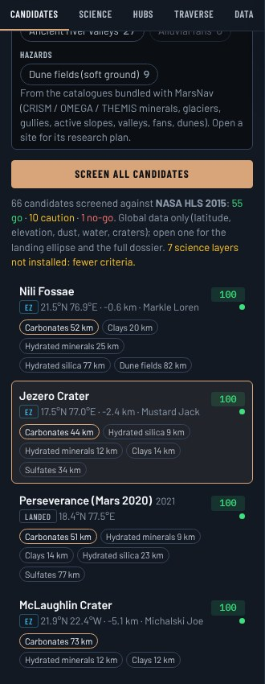</td>
    <td width="34%">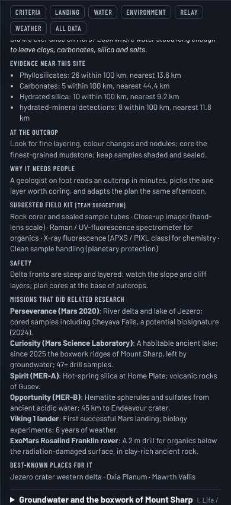</td>
  </tr>
  <tr>
    <td><b>Science filter.</b> Tick what the crew needs nearby: clays, sulfates, silica, carbonates, chlorides, glacier ice, gullies, active slopes, river valleys, fans.</td>
    <td>Carbonates within 100 km: 66 sites become 4 (Nili Fossae, Jezero, the Perseverance site, McLaughlin crater), each with its materials and distances.</td>
    <td><b>Research plan</b> for the site: the question, evidence and distance, what to do at the outcrop, field kit, safety, and the missions that did related work.</td>
  </tr>
</table>

### 2 · Plan a walk you can always come back from

<table>
  <tr>
    <td width="50%">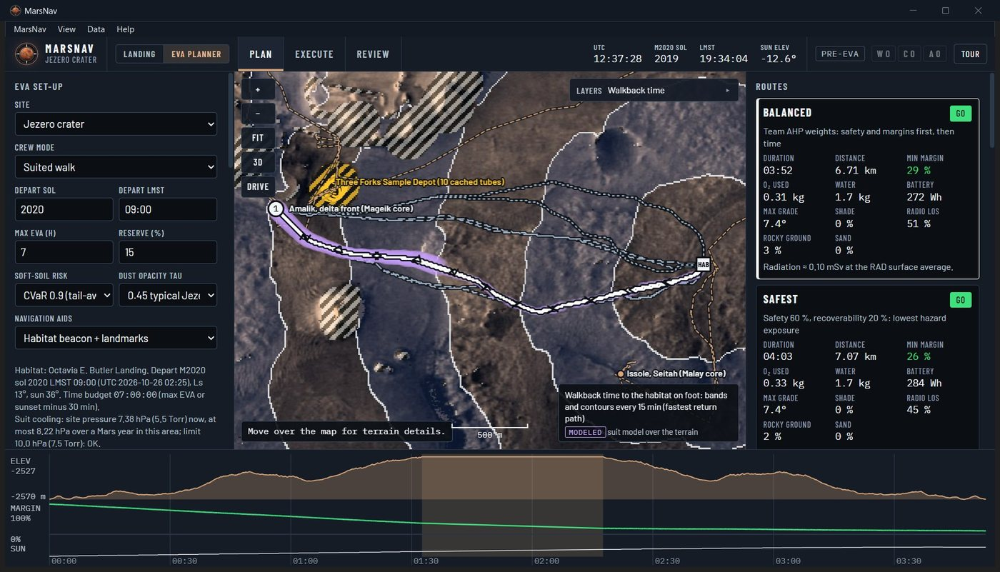</td>
    <td width="50%">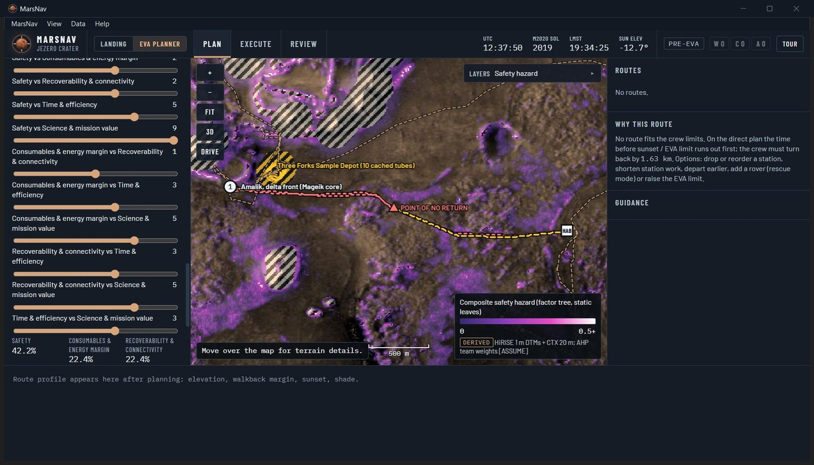</td>
  </tr>
  <tr>
    <td>The walkback field: the true shortest safe time home, and the oxygen, water and battery it costs, from every 10 m cell of 1 m HiRISE terrain.</td>
    <td>When no plan can work, it says where the point of no return is and which resource runs out, instead of "infeasible".</td>
  </tr>
  <tr>
    <td>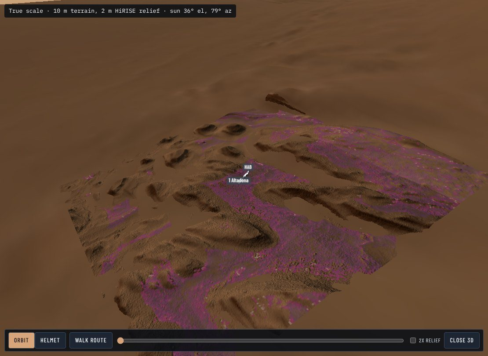</td>
    <td>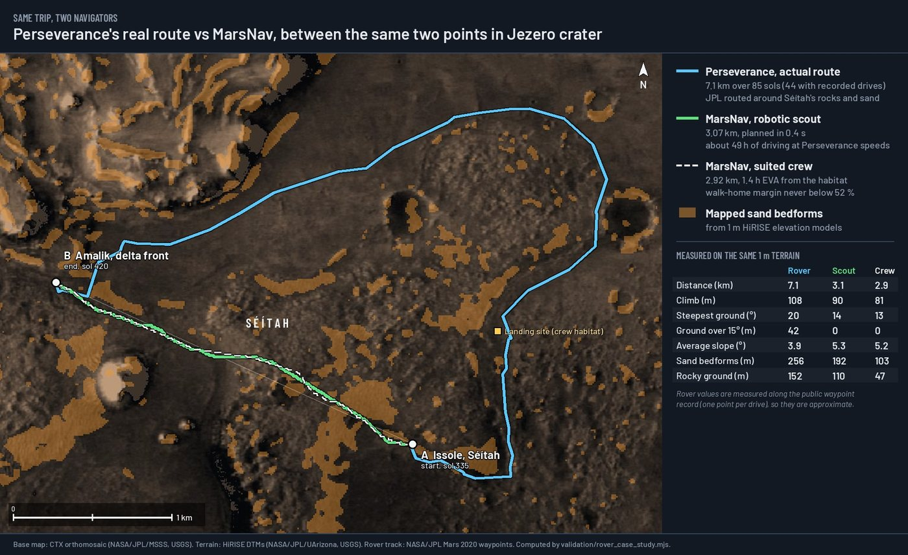</td>
  </tr>
  <tr>
    <td>The challenge's own example, Curiosity's boxwork on Mount Sharp, built from five HiRISE 1 m models. The finding: cliff-bounded buttes and 39 % sand put most of it out of reach on foot, so the hub is a pressurised rover.</td>
    <td>The same trip as Perseverance: JPL drove 7.1 km over 85 sols; MarsNav plans 2.92 km for a suited crew, a 1.4 h EVA with the walk home kept at every step.</td>
  </tr>
</table>

### 3 · Fly it with the crew

<table>
  <tr>
    <td width="50%">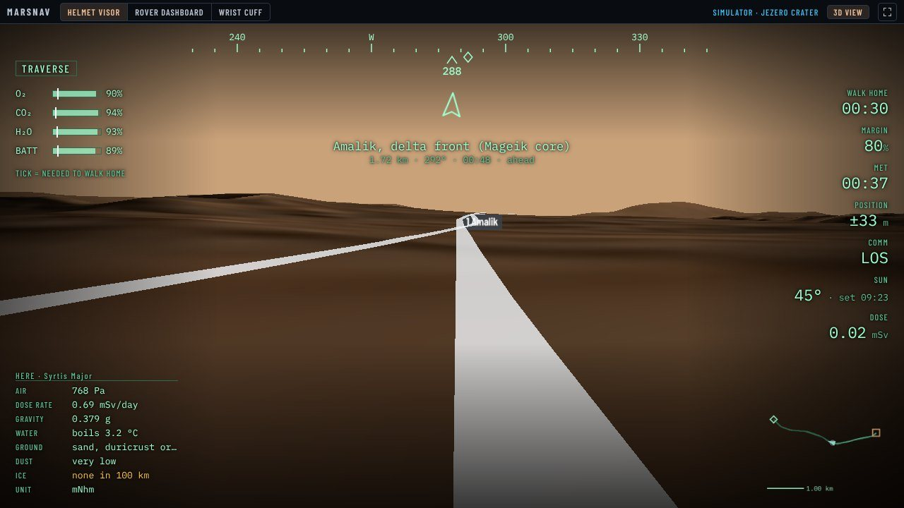</td>
    <td width="30%">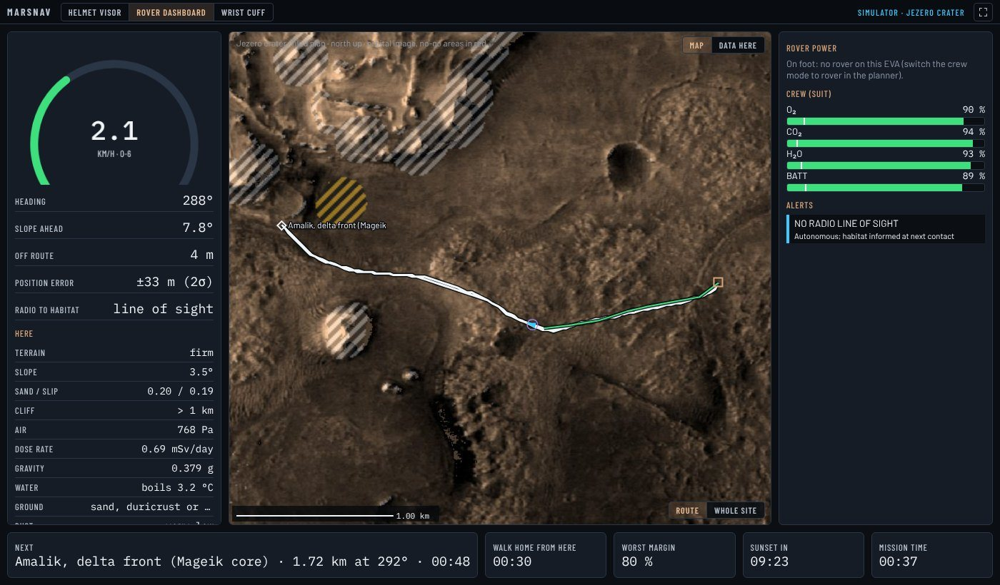</td>
    <td width="20%">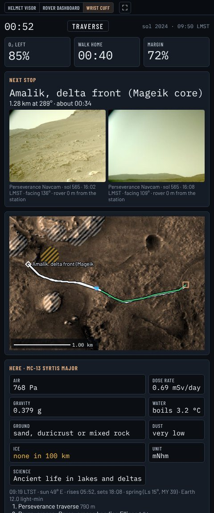</td>
  </tr>
  <tr>
    <td>Helmet-visor HUD: heading, steering cue, walk-home margin, consumables and alerts over the real terrain.</td>
    <td>Rover dashboard: speed, slope ahead, power, route.</td>
    <td>Wrist cuff: the next stop with the rover's own photo of it.</td>
  </tr>
</table>

<table>
  <tr>
    <td width="50%">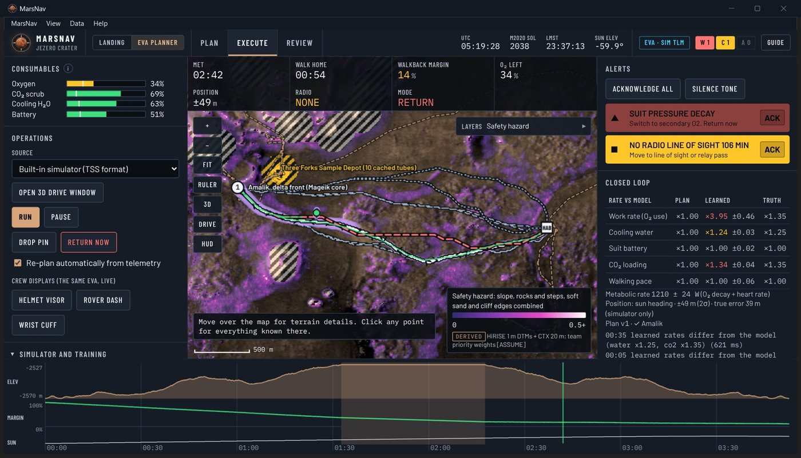</td>
    <td width="50%">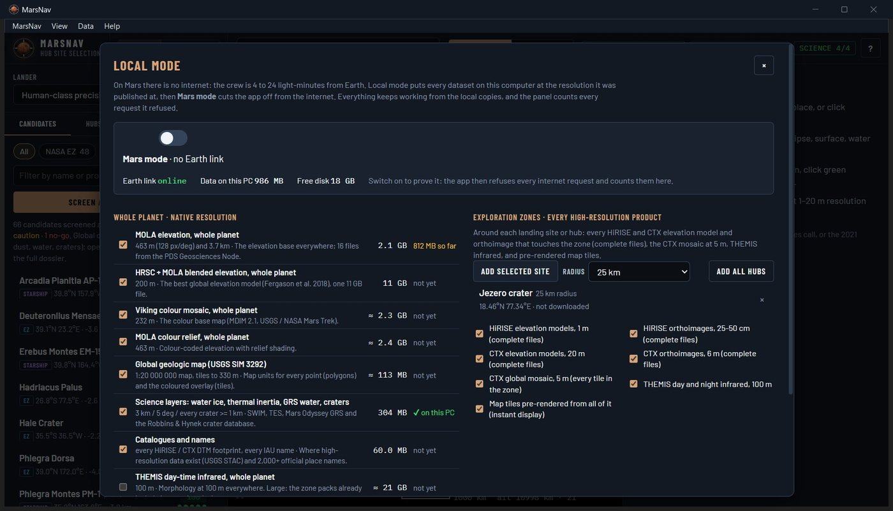</td>
  </tr>
  <tr>
    <td>A suit leak mid-EVA: caution and warning latch, and the plan becomes the walk-home route by itself.</td>
    <td>Local mode downloads every dataset; Mars mode then refuses every internet request and counts what it refused.</td>
  </tr>
</table>

## The closed loop

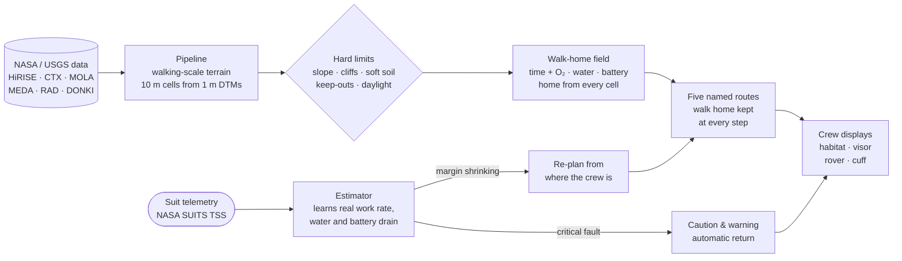

## How it compares

| | The usual Marswalk planner | MarsNav |
|---|---|---|
| **Route** | Shortest or least-slope path on a slope map | Hard vetoes first, then five named routes ranked by time, hazard, consumables, recoverability and science |
| **Walk home** | Checked once, at the turnaround | Kept at every step, inside the search, with the real cost in O₂, water and battery |
| **Soft ground** | A slope threshold | Priced by its worst 10 % of outcomes (CVaR): the way Spirit was lost |
| **During the EVA** | The plan is fixed | Live NASA SUITS telemetry, learned work rates, re-planning, automatic return |
| **Where to land** | Not covered | 66 candidates against NASA's criteria; a hub can be built anywhere on Mars |
| **No GPS** | Assumes the position is known | Navigation filter with its error ellipse; cliff stand-offs grow with drift |
| **No Earth link** | Needs the internet | Local mode and Mars mode; the planner never needs the internet |
| **Radiation** | A single average dose | Dose by altitude and terrain shielding, checked against Curiosity RAD |
| **Evidence** | Screenshots | Checked against Perseverance and RAD, 95 % intervals, tests that fail if the README disagrees |

## Results at a glance

<p align="center">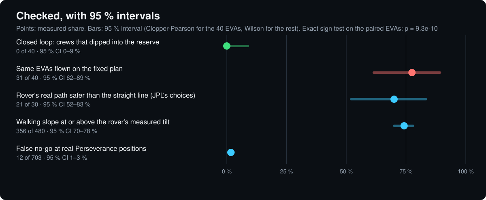</p>

<p align="center">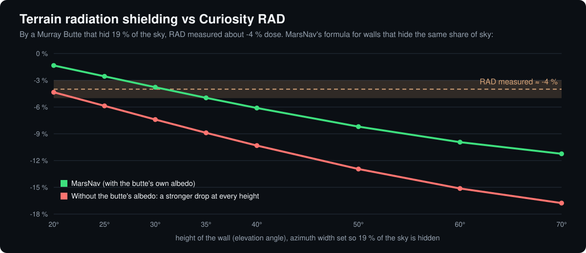</p>

<sub>Both charts are drawn by `tools/make_readme_assets.py` from `validation/results/`, the same files the tests check.</sub>

## What it does

| | |
|---|---|
| **Landing mode** | Whole-planet globe on MOLA, HRSC, CTX and HiRISE data, down to 25 cm imagery. 66 candidates (NASA Exploration Zones, Starship sites, heritage landers) screened in seconds; a dossier for any point on Mars; a safety map of lander-safe ground; long traverses by pressurised rover; "commit the hub" builds the EVA site. |
| **Plan** | Stations with their tasks, suit and rover checkout state, then five routes: balanced, safest, fastest, lowest consumption and a fallback in a different corridor. Each shows time, distance, O₂, water, battery, walk-home margin, radiation dose and data confidence. The best set and order of stations is found exactly (Held-Karp). When no plan can work, it shows the point of no return and the resource that runs out. A 3D view walks the route at eye height against the real crater skyline. |
| **Execute** | Telemetry from the built-in simulator, a first-person drive window, or live from a SUITS Telemetry Stream Server. Live consumables with the walk-home need marked, a navigation filter with its error ellipse (no GPS), caution and warning, station procedures, voice queries, and an automatic return on a critical fault. |
| **Review** | Planned against flown, the event log, the paper cue card crews carry, routes as GeoJSON, and the validation against Perseverance. |
| **Science atlas** | 26 more whole-planet layers (on top of ice, thermal inertia, GRS water, geology and craters), grouped by kind of measurement: spectral (4,572 aqueous-mineral sites, 1,648 CRISM / OMEGA detections, 642 chloride deposits, TES minerals), chemical (GRS H₂O, Fe, Cl, K, Th, Si), thermal and surface, topographic, geophysical (MRO GMM-3 gravity), atmospheric and radiation (pressure, cosmic-ray dose, sunlight), water and ice (glaciers, gullies, fans, valleys), present-day activity (RSL, new and icy impacts), and every rover traverse. The dossier lists what is within 100 km and flags candidate Special Regions. |
| **Science and missions** | A **science filter** keeps only the landing sites that have what the crew needs nearby (clays, sulfates, silica, carbonates, chlorides, glacier ice, gullies, active slopes, river valleys, fans) within 25 to 200 km. Each site's dossier has a **research plan**: the question, the evidence and its distance, what to do at the outcrop, why it needs people, a field kit, safety, and the missions that did related work. In the planner every stop lists the minerals and ice within 30 km and the research it serves. Seven science objectives (ancient life, the Mount Sharp boxwork, ice, present-day activity, volcanism, climate, a place to live): one press shows their layers, another ranks every candidate site. A catalogue of 31 missions, past, active, en route and planned, as of 28 October 2026. |
| **Space weather** | NASA DONKI: CME arrivals forecast at Mars, solar particle events and flares, the Sun-Earth-Mars angle and an EVA advisory (quiet / watch / storm), cached for Mars mode. |
| **Any place** | One click anywhere, on the globe or on a built site, gives every layer at that point (`/api/place`). **Where:** position, USGS chart quadrangle, IAU names, built site. **Time:** local solar time, sun, sunrise and sunset, season and Mars Year, Earth light time (live). **Survival:** air pressure, the liquid-water window, air shielding, cosmic-ray dose, gravity, sunlight, space weather. **Ground:** thermal inertia, geologic unit, albedo, dust cover, roughness, craters. **Water:** SWIM ice at three depths, the nearest ice, GRS hydrogen. **Composition:** TES minerals, GRS elements, mineral detections. **Science:** catalogued features and objective scores. **Context:** missions and candidate sites nearby, and the best elevation data covering it. On a built site the card adds that site's terrain model (slope, steps, sand, wheel slip, cliffs, radio, walk home, the no-go reason) and the rover's photographs. |
| **Crew displays** | Helmet-visor HUD (heading tape, steering cue, walk-home margin, consumables, alerts) over the site's terrain in 3D from the crew's eyes, rover dashboard (speed, slope ahead, power, route map) and wrist cuff (next stop with the rover's photograph, checklist, acknowledge / pin / two-step return), live from the planner; the visor also overlays the drive window. All three show the place under the crew: air, dose rate, gravity, water's boiling point, ground, dust, ice, geology and science nearby. The dashboard and cuff also hold every layer ("Data here"). Opened for any place from Landing mode or a site, they run as a survey: local time, sun and a map of the features within 50 km. |
| **Worldview-style tools** | On Mars data, as NASA Worldview does for Earth: **dust by season** from the Mars Climate Database climatology (MY 24-36), on the globe and in the planner's solar heating; **MRO MARCI daily weather maps** of Mars years 28-32 (the 2007 global dust storm, sol by sol), with a season slider, Play and GIF; **Earth relay coverage** from the orbits of MRO, Odyssey, TGO and Mars Express (passes per sol and local times, drawn on the planner's timeline); the **crustal magnetic field** (MGS); **compare** two maps or two years with a swipe line or spy lens; a **ruler** with area and **statistics of every layer** inside a shape or the landing ellipse; overlay strength and thresholds; **GeoTIFF, KMZ and KML** exports; **links** that restore the whole state; "Get the data" links; and guided **stories**. Details: [`docs/13_worldview_features.md`](docs/13_worldview_features.md). |
| **Offline** | Local mode measures and downloads the whole-planet datasets and every high-resolution product around each site; Mars mode then refuses every internet request. The EVA planner needs no internet at any time. |

## Run it

**Windows 10 or 11 (64-bit):**

1. Download `MarsNav-Windows.zip` from the [latest release](https://github.com/Aryan221224/MarsNav/releases/latest). Every push builds it on a clean Windows machine (`.github/workflows/windows-exe.yml`), starts it, runs its self-test and the whole test suite, and only then publishes it. Or build it yourself with `build_exe.bat` (it appears in `dist\`).
2. Unzip it anywhere you can save files (Desktop, Documents, `D:\`, a USB stick) and double-click **`MarsNav.exe`**.
3. The first time on a new PC, Windows may say "Windows protected your PC" because the program is not code-signed: click **More info**, then **Run anyway**.

**From the source folder** (this repository, or a zip of it): install Python 3.10+ (tick "Add python.exe to PATH"), double-click **`Build_MarsNav.exe`** (or `build_exe.bat`, which it runs) once and wait for "Build complete" (about ten minutes the first time), then double-click **`MarsNav.exe`**. It is in the same folder and on your Desktop as the "MarsNav" shortcut. After that, open `MarsNav.exe` directly.

The first time you open Landing mode the globe streams NASA imagery and elevation; a **Loading map** bar shows the tiles arriving, and the whole-Mars elevation map (33 MB) downloads once in the background. Everything is cached on this computer, so later visits are fast.

No Python, no installer and no admin rights are needed. The window uses Microsoft Edge WebView2, which is part of Windows 10 and 11. For a two-minute tour, press **Guide** in the top bar, then **Quick tour**; the [user guide](MarsNav_User_Guide.pdf) walks through every feature with screenshots.

**In a browser, nothing to install:** [aryan221224.github.io/MarsNav](https://aryan221224.github.io/MarsNav/) runs the EVA planner, the visor HUD and the drive window on the real Jezero terrain (published from `app/` by `.github/workflows/pages.yml`; Landing mode needs the desktop app, which streams and processes the NASA / USGS data).

**Any OS, EVA planner only:** `python3 -m http.server 8765 --directory app`, then open `http://localhost:8765`.

## Checked against Perseverance

Every result is reported, including the ones that did not go our way. Each figure and its 95 % interval is read from [`validation/results/headline.json`](validation/results/headline.json) (written by `validation/headline_stats.mjs` from the validation outputs), and `tests/headline_numbers.test.mjs` fails if this table, the submission text or the result files disagree.

| Check | Result |
|---|---|
| Mars clock vs Perseverance MEDA sun geometry | Solar zenith angle error 0.001 ± 0.086° over 5,616 samples on 117 sols (mean error 95 % CI −0.001 to 0.003°) |
| Terrain vs the rover | Walking-scale slope at or above the rover's measured tilt at 74 % of 480 points (95 % CI 70–78 %; r = 0.72) |
| False no-go rate | 2 % of 703 real Perseverance positions (95 % CI 1–3 %) |
| Hazard model vs JPL's route choices | The rover's real path scores lower than the straight line on 21 of 30 detour drives (70 %, 95 % CI 52–83 %) |
| Route geometry vs the rover's drives | **Not** better than a straight line (38 m vs 34 m): reported as a negative result |
| Closed loop vs flying the filed plan | 40 paired EVAs: 0 of 40 dipped into the reserve with the loop (95 % CI 0–9 %), 31 of 40 without (95 % CI 62–89 %); Wilcoxon p < 0.001, exact sign test on the 31 discordant pairs p = 9 × 10⁻¹⁰ |
| Terrain radiation shielding vs Curiosity RAD | Parked by a Murray Butte with 19 % of the sky blocked, RAD measured about −4 % dose. MarsNav's formula gives −3 % to −10 % for that geometry (a wall 25–60° high), and −6 % to −15 % without the butte's own albedo, which overshoots. Not resolved from orbit: the HiRISE 1 m terrain shows only 5–16 % of the sky blocked within 24 m of the stop (the cliff face is smoothed), so MarsNav's map under-states shelter next to cliffs, the conservative side for dose. Reported as unresolved |
| Against NASA's TSS2027 telemetry server | Detected a battery and CO₂ drain beyond its 8× estimator limit (O₂ about 4×) and turned the EVA home within about 2 minutes |
| Same trip as the rover | Séítah to the delta front: Perseverance drove 7.1 km over 85 sols; MarsNav planned 3.07 km in under a second (a suited crew: 2.92 km, 1.4 h). Over 45 real drives its routes cross 47 % less mapped sand and 55 % less rocky ground than the rover did, and its speed model reproduces the rover's measured 79.7 m/h (79 m/h) |
| Reproducibility | A full rebuild from the raw USGS files gives byte-identical layers |

188 automated tests pass: 102 engine, closed-loop, radiation-shielding, map-tool and headline-number tests (Node) and 86 pipeline, downloader, map-streaming, science-atlas, place, map-tool and headline-statistics tests (pytest). The desktop server passes an end-to-end self-test under load, including a first run from an empty data folder. Details: [`validation/REPORT.md`](validation/REPORT.md), [`validation/ROVER_CASE_STUDY.md`](validation/ROVER_CASE_STUDY.md), [`validation/CLOSED_LOOP.md`](validation/CLOSED_LOOP.md), [`docs/05_verification_and_validation.md`](docs/05_verification_and_validation.md).

## How it works

| Layer | Built with |
|---|---|
| Desktop app | Python launcher compiled with PyInstaller; native window through pywebview on Microsoft Edge WebView2; a supervisor with a Windows job object, health checks and automatic restarts. |
| Interface | HTML, CSS and JavaScript modules, no framework; three.js for 3D; the planning engine in a Web Worker. Display rules informed by NASA-STD-3001 Vol. 2. |
| Planning engine | Plain JavaScript (`engine/`): terrain, cost model, planner, walk-home fields, physiology, Mars clock, environment, AHP, risk (CVaR), sortie selection (Held-Karp, QUBO), simulation, closed loop and navigation filter, caution and warning. The same code runs in the app, the tests and the validation. |
| Planet engine | Python (`planet/`): tile server and disk cache, MOLA / HRSC / CTX / HiRISE readers over GDAL in worker processes, USGS STAC catalogue, landing assessment, site generator, Local mode, SUITS telemetry bridge. |
| Data pipeline | Python with numpy, scipy, rasterio / GDAL and Pillow (`pipeline/`): downloads with SHA-256 checks, walking-scale terrain statistics from 1 m HiRISE models, hazard layers, imagery, weather fit. |

Hard limits come first and are never traded against time; a partial route from which the crew could not walk home is dropped during the search. Only then are routes optimised over time, hazard, consumables, recoverability and science, with weights from AHP and a live consistency ratio. See [`docs/03_algorithms.md`](docs/03_algorithms.md).

## Repository

| Path | Contents |
|---|---|
| `app/` | The application: pages, styles, scripts, the bundled engine, pre-built site data, fonts and three.js |
| `engine/` | The planning engine (JavaScript modules), shared by the app, tests and validation |
| `planet/` | The planet engine and local server: tiles, data readers, landing assessment, site builder, Local mode, telemetry |
| `pipeline/` | The data pipeline and site definitions (`pipeline/sites/*.json`) |
| `launcher/` | The desktop app: launcher, native window, packaging |
| `validation/` | Validation against Perseverance and the closed-loop campaign, with reports |
| `tests/` | Engine and closed-loop tests (Node), pipeline and downloader tests (pytest) |
| `tools/` | Build scripts, the SUITS telemetry bridge, test helpers, the figure script and the user-guide builder (`tools/guide/`) |
| `docs/` | Concept of operations, architecture, algorithms, data provenance, verification, requirements traceability, deployment, limitations, closed loop, the 2026 statement update (`docs/12_challenge_2026_update.md`) and the Worldview-style tools (`docs/13_worldview_features.md`) |
| `submission/` | Project submission text, judging-criteria map, demo script, comparison with other approaches |

## Build and test from source

```bat
Build_MarsNav.exe                     :: Windows: double-click to build MarsNav.exe (runs build_exe.bat; source: tools\build_launcher)
build_exe.bat                         :: Windows: builds MarsNav.exe and dist\MarsNav-Windows.zip (recipe: tools\build_windows.py)
selftest.bat                          :: end-to-end server check under load
python tools\smoke_exe.py dist\MarsNav\MarsNav.exe   :: start the built program, check every page and API, stop it
```

```sh
node --test tests/*.test.mjs          # 102 engine, closed-loop, shielding, map-tool and headline-number tests (Node 20+)
python -m pytest tests -q             # 86 pipeline, downloader, map-streaming, science-atlas, place, map-tool and headline-statistics tests (pip install -r requirements.txt)
node validation/validate.mjs          # validation against Perseverance data (about 30 s)
node validation/rover_case_study.mjs  # same trips as Perseverance, MarsNav vs the rover (about 15 s)
node validation/closed_loop_campaign.mjs   # 40 paired closed-loop EVAs (about 70 s)
bash tools/build_all.sh               # rebuild every data product from the raw USGS / NASA files
GLOBAL_PRODUCTS=1 bash tools/build_all.sh   # also the dust climatology, magnetic field and MARCI index (docs/13)
python tools/build_features.py        # rebuild the whole-Mars feature catalogues from NASA Mars Trek and the rover feeds
python tools/build_pov.py --site jezero --rover m2020   # the rover's photographs at each station
python tools/guide/builder/build.py   # rebuild MarsNav_User_Guide.pdf (pip install reportlab)
```

## Data and credits

Mars data from NASA and the USGS Astrogeology Science Center: HiRISE, CTX, CRISM, MARCI and GMM-3 gravity (MRO), MOLA, TES and the MAG/ER magnetometer (MGS), THEMIS and GRS (Mars Odyssey), HRSC and OMEGA (Mars Express), the MEDA weather station, the rover traverses, raw images and RAD radiation records (Mars 2020, MSL), the Viking colour mosaic, the global geologic map (USGS SIM 3292), the SWIM ice maps, the Robbins & Hynek crater database, the mineral, ice and activity surveys served by NASA Mars Trek, NASA CCMC's DONKI space-weather database, and the Mars Climate Database dust scenarios (LMD, Montabone et al. 2015, 2020). Candidate sites from NASA's 2015 Human Landing Sites workshop and Golombek et al. (2021). Full provenance and citations: [`docs/04_data_and_provenance.md`](docs/04_data_and_provenance.md) and the user guide.

MarsNav is an independent project built for the NASA Space Apps Challenge 2026. It is not a NASA product and is not endorsed by NASA.

**Use of AI.** We used an AI coding assistant (Anthropic's Claude) to help write, test and document MarsNav to the team's design; the team reviewed and tested every change. The logo was made with an AI image generator. All data is real mission data and every result can be re-run from the code. Details: [`docs/AI_USE.md`](docs/AI_USE.md).

Fonts: Barlow and IBM Plex Mono (SIL Open Font License). 3D: three.js (MIT).

## License

MIT. See [`LICENSE`](LICENSE).
