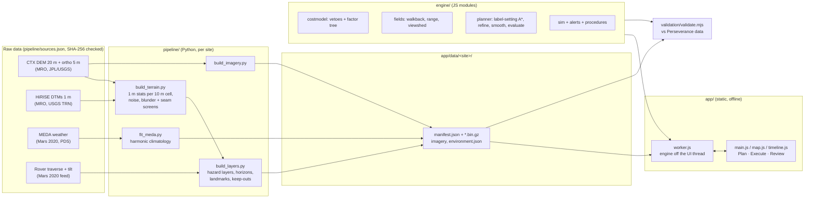

# Architecture

About 7,800 lines of our own code in three parts: a Python data pipeline that runs once per site, a JavaScript planning engine, and a static web app that runs the engine in a background worker. The engine is one set of ES modules, used unchanged by the app, the tests and the validation.



## Pipeline (Python, `pipeline/`)

| Module | Responsibility |
|---|---|
| `sitecfg.py`, `sites/*.json` | Everything specific to a place: area, projection, habitat, sources, calendar, targets, keep-outs. `--site <id>` selects one. |
| `fetch_data.py`, `sources.json` | Downloads each input from its canonical URL (with a mirror fallback), resumes partial files and checks the SHA-256 |
| `mars_geo.py` | Mars 2000 sphere, equirectangular projection with a per-site standard parallel, grids snapped to the source DEM |
| `build_terrain.py` | Regional DEM on the 10 m grid. Blunder screen (spikes and pits) and mosaic-seam repair. Each 1 m DTM processed separately in 1 km chunks with a 48 m halo, giving walking-scale slope (p90, max, share over 20/25/30°), step, roughness and a bedform detector. Noise floors are removed per product, then elevation is blended with a feathered offset. |
| `build_layers.py` | Hazard layers: walking slope with a CTX calibration where there is no 1 m data, soft-soil slip μ and σ, cliff distance, landmarks, keep-outs, science value, 16-sector horizon angles with Mars curvature. Auto-sites a habitat and survey stations for a new site. |
| `build_imagery.py` | Orthoimage basemap, 2 m hillshade tiles where 1 m DTMs exist, regional relief |
| `fit_meda.py`, `mars_time.py` | 63-term harmonic fit (season × time of day) of MEDA air, ground and atmospheric-sensor temperatures and pressure (log, with an elevation term). A Python port of Mars24. |

Layer format: gzip-compressed little-endian uint8/uint16 arrays with a scale and offset in `manifest.json`. That is about 14 MB for the whole Jezero operations area (2.3 million cells at 10 m) and 6.6 MB for the CTX-only site. Browsers decode it natively with `DecompressionStream`, with no library.

## Engine (JavaScript, `engine/`)

| Module | Responsibility |
|---|---|
| `terrain.js` | Loads a site in the browser or in Node, and sets the site's projection |
| `geo.js`, `heap.js`, `util.js` | Geodesy, a structure-of-arrays min-heap, chamfer distance transform, Bresenham lines |
| `marstime.js` | Mars24 (Allison and McEwen 2000): Ls, sun position, LMST and LTST, mission calendars (M2020, or any landing epoch) |
| `environment.js` | Sun and shade from horizon maps, direct and global irradiance for a dust opacity τ, the MEDA climatology, sunset and sunrise |
| `physio.js` | Apollo walking speeds and slope footing, the Minetti walking cost scaled to Mars gravity, metabolic power to O₂, CO₂ and water, suit heat balance, vehicle speed and power, crew profiles |
| `ahp.js`, `risk.js` | Analytic Hierarchy Process weights with a consistency ratio, the team's documented judgements, and normal-distribution risk measures (CVaR) |
| `costmodel.js` | Fine (10 m) and coarse (40 m) plan grids: 8 veto reasons, static hazard leaves weighted by AHP, and a time-dependent edge cost (speed, consumables, shade, cold, sun) |
| `fields.js` | Backward Dijkstra walkback field (time and every consumable home, from every cell), consumables-aware range, radio viewshed from the habitat mast with Mars curvature |
| `planner.js` | Multi-criteria route planning (see algorithms). Named routes, multi-stop sorties, data-quality flags and dose. |
| `sortie.js`, `qubo.js` | Station selection: exact Held-Karp dynamic programming over subsets up to 15 candidates; a QUBO solved by simulated annealing, with 2-opt, Or-opt and swap repair, beyond that (docs/11) |
| `task.js` | Stated station tasks: work time, intensity, tool energy and extra consumables priced into every plan (docs/10) |
| `telemetry.js`, `nav.js`, `estimator.js`, `replan.js`, `live.js`, `stats.js` | The closed loop: NASA SUITS TSS telemetry parsing, the navigation EKF (dead reckoning, sun, landmark, beacon), rate and slip estimators, receding-horizon re-planning, the live telemetry session, and paired statistics (docs/09) |
| `sim.js`, `alerts.js`, `procedures.js` | Time-stepped EVA simulation with a hidden truth that emits TSS-format telemetry, the forecast-and-re-plan monitor, faults, automatic return, pins, crew abort, the NASA-style alert manager and station procedures |
| `report.js`, `sitecheck.js` | Cue card (Douglas-Peucker guidance legs), GeoJSON, suit-cooling pressure envelope, EVA dose |

## App (`app/`)

- `worker.js` holds one copy of the terrain and all models in a module Web Worker, so planning never freezes the map. The UI gets images, route summaries and snapshots through messages.
- `view3d.js` is the 3D view (three.js, vendored so it works offline). The local terrain is the 10 m DEM around the route, draped with the orthoimage, the 2 m HiRISE relief and the active overlay. The far terrain is the whole-crater DEM, so the helmet view's skyline is the real crater rim. Mars curvature is applied, the scale is true by default, and the sun is at its real position for the departure time. "Walk route" moves a 1.8 m eye along the route with the plan's time, grade, walk-home time and margin at each point. The crew displays use the same view behind the helmet visor ("crew" mode: the eye follows the crew's position and heading, the routes are painted on the ground), loading only the two elevation layers (`Terrain.elevWindow` and `regionalWindow`, shared with the worker) and the orthoimage.
- `map.js` draws on a canvas. It shows the orthoimage, 2 m HiRISE tiles when zoomed in, overlays, and the route with a white core, dark casing and violet 2σ corridor, plus chevrons, keep-outs, pins, crew, and the return route.
- `index.html` and `css/app.css` implement the NASA-informed display: a dark theme, colours reserved for status (red, amber, green, cyan), violet for uncertainty, fixed-width digits and units everywhere.
- `sw.js` caches the app shell and each file on first use, so a standalone deployment works with no network. It is skipped when the app is embedded in a viewer that does not allow service workers.

## Added for the 2026 statement

| Module | Responsibility |
|---|---|
| `planet/features.py` | The bundled feature catalogues (minerals, ice landforms, activity, dunes, valleys, landers, traverses): drawing on tiles, radius queries, the "science along the way" context and the planetary-protection flag |
| `planet/atlas.py` | TES mineral and dust maps and MOLA roughness from Mars Trek; model layers for air pressure, cosmic-ray dose and sunlight; the layer catalogue grouped by kind of measurement |
| `planet/datasets.py` (extended) | GRS elements, TES albedo, MRO GMM-3 gravity (spherical harmonics summed on a 0.25° grid) |
| `planet/science.py` | Mission catalogue and science objectives; scores and ranks places by the evidence near them |
| `planet/spaceweather.py` | NASA DONKI client, offline cache, Sun-Earth-Mars geometry and the EVA advisory |
| `app/hud.html`, `app/js/hud.js` | Crew displays: helmet visor HUD, rover dashboard, wrist cuff, fed by the planner over a BroadcastChannel |
| `tools/build_features.py`, `tools/build_pov.py`, `tools/add_rover_context.py` | Rebuild the bundled catalogues, the station photographs, and a site's rover context (traverse, stations, keep-out, clock) |

## Performance (one 2.1 GHz Xeon core, Node 22)

| Step | Time |
|---|---|
| Load the Jezero site (16 layers, 2.3 M cells) | 0.2 s |
| Build the foot cost model (fine and coarse grids) | 0.7 s |
| Walkback field over the whole area | 0.3 s |
| Five named routes, habitat to one station and back | 3.0 s |
| Five named routes, two stations | 3.3 s |
| Sortie optimiser, 7 candidates, up to 3 stops | 0.9 s |

## Closed loop and hardware

```
suit / rover ──UDP──► NASA SUITS TSS ◄──UDP── tools/tss_bridge.mjs ──SSE /events──► app main thread ──► worker: LiveSession
                                                   ▲                                                         │
                                                   └──────────── POST /plan (every re-plan) ◄────────────────┘
                                                   GET /plan ──► helmet display
```

The simulator (`EvaSim`) and the live session (`LiveSession`, which extends it) share the navigation filter, estimators, forecast, re-planner and caution and warning. Only the source of frames differs. See docs/09 for the interface.
